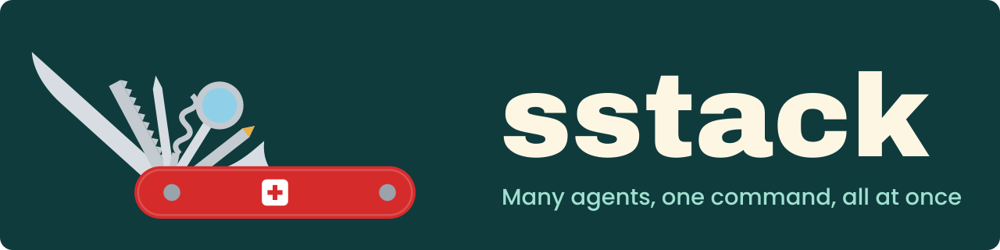

<p align="center">
  
</p>

<p align="center">
  <a href="LICENSE"></a>
  <a href="https://github.com/GeiserX/sstack/releases"></a>
  <a href="https://github.com/GeiserX/sstack/stargazers"></a>
</p>

# sstack

sergio stack: skills for [Claude Code](https://claude.com/claude-code) and [Codex](https://developers.openai.com/codex) that drive a repo to done, review and investigate in parallel, and ship it.

## Install

<details>
<summary><b>Claude Code plugin</b></summary>

```text
/plugin marketplace add GeiserX/sstack
/plugin install sstack@sstack
```

On Claude Code 2.1.275 or later, `/plugin install sstack --marketplace GeiserX/sstack` does both in one step. Plugin skills are namespaced, so you call them as `/sstack:file-pr`, `/sstack:full-loop` and so on.

</details>

<details>
<summary><b>npx skills</b></summary>

```bash
npx skills add GeiserX/sstack
```

</details>

<details>
<summary><b>Symlinks with the installer</b></summary>

```bash
git clone https://github.com/GeiserX/sstack && cd sstack && scripts/install.sh
```

Name skills to link only those (`scripts/install.sh file-pr revive`). Anything already installed under the same name is moved to `~/.claude/skills-backups/` first. The sergio-loop Stop hook needs `--hooks`, which links the runtime into `~/.claude/hooks` and prints the `settings.json` entries to add.

</details>

<details>
<summary><b>Codex</b></summary>

```bash
scripts/install.sh --codex
```

This links `codex/skills/` into `~/.agents/skills/`. Call a skill as `$<name>`. The Stop hook is Claude Code only, so in Codex a loop runs one pass per call.

</details>

Pick one route for Claude Code. With both the plugin and the symlinks, every skill shows up twice.

## Skills

### Loops

| Skill | Say | What it does |
|---|---|---|
| [`full-loop`](skills/full-loop/SKILL.md) | `/full-loop <goal>` | Runs sergio-loop until nothing is pending, then refine-loop at a falling theta. |
| [`sergio-loop`](skills/sergio-loop/SKILL.md) | `/sergio-loop <goal>` | A durable goal loop: one small slice at a time, goals and evidence in `docs/`, resumable state in `.omc/sergio-loop/`. |
| [`refine-loop`](skills/refine-loop/SKILL.md) | "keep improving this repo" | Small, behaviour-preserving improvements ranked by `ROI = Impact × Confidence ÷ Effort`, each checked by a fresh reviewer. |
| [`docs-loop`](skills/docs-loop/SKILL.md) | "audit the docs" | Checks documentation against the default branch: dry run, staged edits, or one pull request per repo. Never merges. |

### Parallel work

| Skill | Say | What it does |
|---|---|---|
| [`investigate`](skills/investigate/SKILL.md) | `/investigate <bug>` | Independent hypothesis agents take a failure from reproduction to root cause, and fix it only when asked. |
| [`research`](skills/research/SKILL.md) | `/research <question>` | Parallel specialists gather evidence from the code, its history and primary sources, then a ranked, cited answer. |
| [`review-code`](skills/review-code/SKILL.md) | `/review-code` | Audits a whole codebase in bounded waves and publishes every verified finding by severity. |
| [`review-pr`](skills/review-pr/SKILL.md) | "review PR 42" | Three review lenses, one fixer and one adversarial verifier per pull request, then merge or close. |
| [`implement`](skills/implement/SKILL.md) | `/implement <change>` | The smallest complete change, with independent parts split across agents that own separate files. |

### Knowledge base

| Skill | Say | What it does |
|---|---|---|
| [`kb-research`](skills/kb-research/SKILL.md) | `/kb-research <question>` | Answers from your team's own record through one adapter file, every claim cited. |
| [`kb-review`](skills/kb-review/SKILL.md) | `/kb-review <PR>` | Reviews a pull request the way your reviewers do, grounded in past decisions. Reports only. |

### Shipping and growth

| Skill | Say | What it does |
|---|---|---|
| [`file-pr`](skills/file-pr/SKILL.md) | "open a PR" | A ready pull request whose title says why and whose body opens with the problem. |
| [`github-video-embed`](skills/github-video-embed/SKILL.md) | "make the video play in the README" | Gets a video onto GitHub as an attachment, so it plays inline in a doc or pull request. |
| [`grow-my-repo`](skills/grow-my-repo/SKILL.md) | `/grow-my-repo` | Plans where an open-source repo gets listed and does the submissions an agent may do. |
| [`submit-awesome`](skills/submit-awesome/SKILL.md) | `/submit-awesome` | One entry per awesome list, by each list's own rules. |

### Communication

| Skill | Say | What it does |
|---|---|---|
| [`verified-reply`](skills/verified-reply/SKILL.md) | "draft a reply to this" | A reply you send as yourself, every claim checked against a live source first. |
| [`eli5`](skills/eli5/SKILL.md) | "eli5" | Explains work or a system in plain words with real names. |
| [`help-decide`](skills/help-decide/SKILL.md) | "help me decide" | Lays a decision out so one word answers it. |

### Recovery

| Skill | Say | What it does |
|---|---|---|
| [`revive`](skills/revive/SKILL.md) | "continue" after a limit or crash | Brings cut-off work back where it really stopped, checking the world before every write. |

None of them treats a stored goal as permission to merge, publish or deploy.

## Some skills call others

- `full-loop` runs `sergio-loop` to done, then `refine-loop`.
- `review-code` hands any finding that would change behaviour to `sergio-loop` or `investigate` instead of fixing it.
- `file-pr` uses the `github-video-embed` recipe when a UI change needs a recording in the pull request.
- `docs-loop`, `refine-loop`, `sergio-loop` and `full-loop` share the loop contract in `shared/loop-contract.md`; the validator checks that every loop carries the same copy.

## Make them yours

The skills here are generic on purpose. Put your own policy (which branches, which reviewers, which words to avoid) in your `CLAUDE.md` or `AGENTS.md`, never in the skill, so updates stay a clean pull.

## Skills shipped with my other projects

- [akou](https://github.com/GeiserX/akou) ships `akou` (record a call and ask about it while it runs) and `akou-vocab` (teach it the names a recording should spell right).
- [unsent](https://github.com/GeiserX/unsent) ships `unsent-context`, which fills in the context of the prompts you sent.

## Other people's skills (credits)

`vendor/` keeps skills written by other people as pinned snapshots with their licences:

- [pstack](https://github.com/cursor/plugins/tree/main/pstack) by Lauren Tan (MIT), 52 skills such as `unslop`, `blast-radius` and `show-me-your-work`. Upstream installs it with `/plugin install pstack@cursor-plugins`. Sources and local changes: [vendor/pstack/PROVENANCE.md](vendor/pstack/PROVENANCE.md).
- `writing-for-agents` from Matt Pocock's [skills](https://github.com/mattpocock/skills) (MIT): [vendor/mattpocock-skills/PROVENANCE.md](vendor/mattpocock-skills/PROVENANCE.md).
- `frontend-design` from Anthropic's [skills](https://github.com/anthropics/skills) (Apache-2.0): [vendor/anthropic-skills/PROVENANCE.md](vendor/anthropic-skills/PROVENANCE.md).

Neither the plugin nor `npx skills` installs anything from `vendor/`. Link the ones you want by hand.

## Documentation

The full documentation is at https://geiserx.github.io/sstack/: [getting started](https://geiserx.github.io/sstack/getting-started/), [usage](https://geiserx.github.io/sstack/usage/), [development](https://geiserx.github.io/sstack/development/) and [related projects](https://geiserx.github.io/sstack/related/).

## License

[GPL-3.0-or-later](LICENSE)
